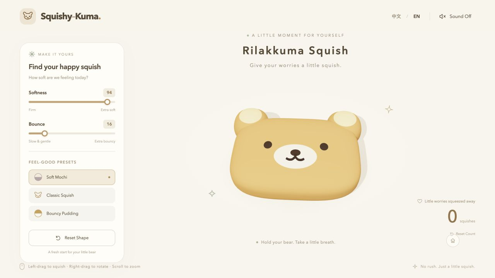

# Squishy-Kuma

Squishy-Kuma is a small 3D stress-relief game that runs in the browser. It recreates a soft, head-only bear squishy with rounded ears and a matte toy-like finish. Press or drag anywhere on the bear to create a local dent, then release it and watch it spring back.

The project is designed for anyone who wants a quick, gentle break in the browser. The interface is simple enough for first-time players, while adjustable softness and bounce settings let users find the feel they enjoy most.

## Live Demo

[Play Squishy-Kuma on GitHub Pages](https://shuniii1010.github.io/Squishy-Kuma/)

## Screenshot



## Screen Recording

The recording will demonstrate the sound effects, local deformation, dragging, and spring-back animation.


[Watch the Squishy-Kuma screen recording on vimeo](https://vimeo.com/1240124605)

## Main Interaction

The bear is not animated by scaling the entire model. Each successful press affects a local area around the pointer, so pressing the forehead, cheek, or muzzle creates a dent in that specific location. Nearby details move with the surface, and a simplified spring-and-damping system restores the original shape after release.

| Action | Result |
| --- | --- |
| Hold the left mouse button on the bear | Dents the selected area and adds one squish |
| Drag while holding | Gently pulls the surface; the same hold still counts only once |
| Release | Restores the shape using the current bounce setting |
| Drag with the right mouse button | Rotates the camera around the toy |
| Scroll | Zooms the camera in or out |
| Select the home button | Returns to the default camera view |
| Change **Softness** | Controls how easily and deeply the bear deforms |
| Change **Bounce** | Controls the speed and amount of spring-back motion |
| Select **Reset Shape** | Removes deformation and residual movement without changing settings or the count |
| Select **Reset Count** | Clears only the saved squish count |

Three presets are included: **Soft Mochi**, **Classic Squish**, and **Bouncy Pudding**. The top-right controls switch between Chinese and English and turn sound on or off. Language, sound, feel settings, the selected preset, and the squish count are saved in the current browser.

## Features

- Procedurally generated 3D bear head with no external model download
- Smooth local pressing, pulling, and spring-back deformation
- Independent softness and bounce controls that update immediately
- Three feel presets plus a separate shape reset
- Chinese and English interface
- Synthesized Web Audio effects with no external audio files
- Persistent settings and squish count using browser storage
- Mouse controls for squishing, camera rotation, and zoom
- Single-finger squishing on mobile devices
- Responsive layout for desktop and mobile screens
- Static GitHub Pages build and optional local Flask server

## Run Locally

```bash
uv run --with-requirements requirements.txt python app.py
```
### Alternative: using venv and pip
#### macOS or Linux

Python 3.10 or later is required. Open a terminal in the project folder and run:

```bash
python3 -m venv .venv
.venv/bin/python -m pip install -r requirements.txt
.venv/bin/python app.py
```

Open `http://127.0.0.1:5000` in a browser. Keep the terminal open while playing and press `Ctrl+C` to stop the server.

After the dependencies have been installed once, future sessions only require:

```bash
.venv/bin/python app.py
```

#### Windows

Install Python 3.10 or later and enable the option that adds Python to `PATH`. Open PowerShell in the project folder and run:

```powershell
py -m venv .venv
.\.venv\Scripts\python.exe -m pip install -r requirements.txt
.\.venv\Scripts\python.exe app.py
```

Then open `http://127.0.0.1:5000`. The virtual environment does not need to be activated, and the PowerShell execution policy does not need to be changed.

If port 5000 is already in use, add a different port to the final command:

```bash
.venv/bin/python app.py --port 5055
```

Then open `http://127.0.0.1:5055`.

> Do not open `templates/index.html` directly with a `file://` URL. Run the local server and open its HTTP address instead.

## GitHub Pages Deployment

The project includes a GitHub Actions workflow at `.github/workflows/pages.yml`. It runs:

```bash
uv run build_site.py
```

The build script generates a static website in `site/`, which the workflow uploads and deploys to GitHub Pages. Flask is not required on GitHub Pages. See [GITHUB_PAGES.md](GITHUB_PAGES.md) for the complete setup instructions.

## How It Works

- **Rendering:** Three.js 0.180.0 and OrbitControls are included locally in `static/vendor/`; the game does not load them from a CDN.
- **Model:** A high-resolution procedural superellipsoid forms the thick bear head. The ears and facial details use the same deformation coordinate space so they follow the surface.
- **Deformation:** Bounded Gaussian influence fields create local dents and pulls instead of scaling the complete toy.
- **Recovery:** A fixed-step spring-and-damping simulation provides stable restoration and controlled overshoot.
- **Audio:** Web Audio generates short squish and release sounds. Audio is enabled only after a user gesture, as required by browser autoplay rules.
- **Storage:** Browser local storage preserves language, sound, feel settings, preset, and the cumulative squish count.

No external model or audio asset is used. Third-party software and license information is listed in [THIRD_PARTY.md](THIRD_PARTY.md).

## Project Structure

```text
.github/workflows/pages.yml  GitHub Pages build and deployment
build_site.py                Static build script; outputs site/
GITHUB_PAGES.md              Publishing instructions
app.py                       Optional local Flask server
requirements.txt             Python dependencies
package.json                 Optional Node.js test command
templates/index.html         Page structure
static/style.css             Responsive styles
static/js/app.js             UI setup and module wiring
static/js/model.js           Procedural bear geometry
static/js/physics.js         Local deformation and spring simulation
static/js/scene.js           Rendering, lighting, picking, and pointer input
static/js/camera.js          Camera controls and gesture cleanup
static/js/state.js           Settings and count persistence
static/js/i18n.js            Centralized Chinese and English copy
static/js/audio.js           Synthesized sound effects
static/vendor/               Three.js, OrbitControls, and license files
tests/                       Node.js and Python tests
docs/TEST_RESULTS.md         Verification results and detailed limitations
```

## Tests

Run the Python tests with:

```bash
.venv/bin/python -m unittest discover -s tests -p 'test_*.py'
```

With Node.js 20 or later installed, run the physics, geometry, audio scheduling, and camera tests with:

```bash
npm test
```

Node.js is used only for tests and is not required to run the game.

## Known Limitations

- The soft-body behavior is a stable visual approximation, not a volume-preserving finite-element simulation. Pulling and deformation are intentionally limited to prevent unstable shapes and self-intersection.
- The model is a procedural interpretation of the reference image, not a 3D scan of the physical toy.
- Mobile devices support single-finger squishing, but multi-touch camera rotation and pinch-to-zoom are not included in the first version.
- Browser and device support varies. A modern browser with WebGL 2, ES modules, and hardware acceleration is recommended.
- Mobile browsers and in-app browsers may require the first tap before audio can start. The browser tab, device media volume, and sound control must also be enabled.
- Browser data is stored separately for each origin, so settings saved on `localhost:5000` are different from those saved on `127.0.0.1:5055` or the live GitHub Pages site. Clearing site data resets saved settings and counts.
- The Windows instructions are provided but have not been verified on a physical Windows machine.
- Performance has not been benchmarked across every browser, older GPU, or high-refresh-rate device, so a constant 60 FPS is not guaranteed.

More detailed verification notes are available in [docs/TEST_RESULTS.md](docs/TEST_RESULTS.md).
